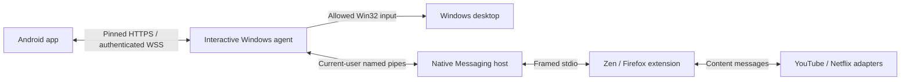

# Architecture

## Components

- **Android:** Kotlin, Jetpack Compose and Material 3, ViewModel/StateFlow, Coroutines, OkHttp for HTTPS/WSS, Android NSD and Keystore-backed credential encryption. Native sharing is the required YouTube selection flow; no Google credentials are collected.
- **Windows:** C#/.NET 10 LTS, WPF control window and system tray, running as the logged-in user. ASP.NET Core/Kestrel provides the local TLS endpoint. Win32 input APIs provide an explicitly allowed set of universal actions; a Windows Service cannot interact with the user's desktop reliably and is unnecessary here.
- **Extension:** TypeScript/WebExtensions for Firefox and Zen, with isolated YouTube and Netflix content adapters. Native Messaging connects the background extension to a per-user Windows bridge; a restricted named pipe connects bridge processes to the interactive agent. No website can connect to a localhost control port.
- **Contracts:** [protocol v1](../contracts/protocol.md) defines messages, validation, queue ownership and compatibility. [Shared URL cases](../contracts/youtube-url-cases.json) guard cross-component link validation.

## Trust and state

Discovery finds an address, not a trusted identity. Pairing requires a Windows-displayed TLS fingerprint, temporary code and local approval. Android retains independent credentials per computer. Revocation invalidates credentials and closes existing connections. See [security](security.md).

Windows owns and persists the YouTube queue. Android edits it through commands, and the extension reports player state. Only a natural end of the active matching video advances once. Manual video changes detach the current queue item; tab close/reload and transport loss never imply completion. Full state snapshots repair synchronization after reconnect. Autoplay and fullscreen restrictions remain visible rather than being reported as success.

The universal remote remains usable without the extension. The extension reports actual available capabilities so Android can expose contextual controls and a universal fallback. Multiple browser/tab sessions have agent-assigned identities.

## Compatibility and distribution

One application SemVer covers all artifacts; protocol major v1 defines wire compatibility. Build-time properties stamp Android, Windows and extension versions. The release workflow tests and packages all components before publishing in the same flow. Missing signing or physical validation keeps the distribution explicitly incomplete and prevents stable publication. See [release setup](releasing.md).

User settings, pairings and queue live outside the installation directory; normal Windows upgrades preserve them. Android updates require the same package ID and signing key. Extension upgrades keep the fixed add-on ID and an increasing numeric Mozilla version.

## Research and limits

The stack uses official platform mechanisms: [Android architecture](https://developer.android.com/topic/architecture), [Compose BOM](https://developer.android.com/develop/ui/compose/bom), [NSD](https://developer.android.com/develop/connectivity/wifi/use-nsd), [.NET support lifecycle](https://learn.microsoft.com/en-us/lifecycle/products/microsoft-net-and-net-core), [SendInput](https://learn.microsoft.com/en-us/windows/win32/api/winuser/nf-winuser-sendinput) and [Mozilla Native Messaging](https://developer.mozilla.org/en-US/docs/Mozilla/Add-ons/WebExtensions/Native_messaging). SendInput cannot control elevated applications across Windows integrity boundaries; the agent does not request routine elevation.

[Zen documents a Widevine licensing limitation](https://docs.zen-browser.app/faq#why-cant-zen-browser-play-drm-protected-content). [Netflix lists Firefox among supported browsers](https://help.netflix.com/en/node/30081); this does not establish support for Zen. Use Firefox as the first compatible DRM fallback while preserving Zen as the primary YouTube target. Real playback and quality must be tested on the installed browser/hardware; do not bypass DRM.

[YouTube Data API search](https://developers.google.com/youtube/v3/docs/search/list) requires project credentials and quotas; native search remains in the roadmap so it cannot delay sharing/queue delivery. [KDE Connect remote input](https://userbase.kde.org/KDEConnect/en) and [Unified Remote basic input](https://www.unifiedremote.com/remotes/basic-input) informed the separation of navigation, touchpad and media controls, without copying code or layouts.
